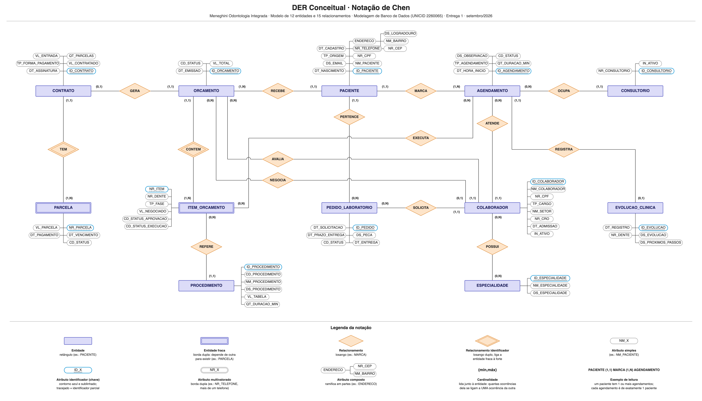

# 🗄️ Modelo Conceitual da Meneghini Odontologia Integrada

## 📝 Descrição do Projeto
Este projeto é a Entrega 1 da disciplina de **Modelagem de Banco de Dados (2026.2)**, com o professor Cid Rodrigues de Andrade. O desafio era escolher uma organização real de pequeno porte, levantar como ela funciona e construir o **modelo conceitual (DER)** de um sistema que organize os dados dela sem redundância e sem inconsistência.

A organização escolhida foi a **Meneghini Odontologia Integrada**, uma clínica particular no Jardim São Paulo (SP), com dentistas de várias especialidades, laboratório próprio de próteses e cerca de 30 colaboradores. Parte das informações da clínica fica espalhada entre o software de gestão, planilhas e a comunicação entre os setores. O modelo cobre o caminho do paciente dentro da clínica: avaliação, orçamento, contrato, parcelas, consultas, evolução clínica e pedidos ao laboratório.

Trabalho em grupo com Leonardo Alves Tavares Calixta e David Carlos da Fonseca Junior. A pesquisa de campo (visita, entrevista com o proprietário e observação do funcionamento) foi feita por mim em nome do grupo.

## 🚀 Tecnologias Utilizadas
* **Modelagem:** Modelo Entidade-Relacionamento em notação de Chen, com cardinalidade `(mín,máx)` na convenção do brModelo/Heuser
* **Documentação:** Markdown e dicionário de dados em HTML/CSS publicado no GitHub Pages
* **Versionamento:** Git e GitHub, com branch e pull request para cada ajuste
* **Apoio de IA:** Claude, para organizar o rascunho e gerar as imagens do DER e dos fluxogramas. O grupo revisou cada entidade, relacionamento e cardinalidade, e o uso está registrado na Seção 9 do trabalho original.

## 📊 Resultados e Aprendizados
O modelo final tem **12 entidades e 15 relacionamentos**, sendo 2 do tipo N:N, que vão virar tabelas intermediárias no modelo lógico (Entrega 2).

* **Cardinalidade a partir da entrevista:** cada `(mín,máx)` saiu de uma resposta da pesquisa de campo, e algumas mudaram depois de conferir com a clínica. Exemplo: PACIENTE e ORCAMENTO passou de "0 ou mais" para "1 ou mais", porque toda avaliação gera um orçamento.
* **Entidade ou atributo:** ESPECIALIDADE virou entidade (N:N com COLABORADOR) porque um dentista pode ter mais de uma. Já a origem de captação virou só o atributo `TP_ORIGEM` do paciente.
* **Entidade fraca:** ITEM_ORCAMENTO e PARCELA só existem dentro do orçamento e do contrato. Cada item tem aprovação própria e cada parcela tem baixa própria, por isso são identificados pelo número dentro da entidade forte.
* **LGPD no desenho:** a evolução clínica ficou em uma entidade separada do agendamento, por ser dado sensível de saúde com acesso restrito.
* **Redundância:** retiramos a ligação entre COLABORADOR e EVOLUCAO_CLINICA, porque o agendamento já guarda qual dentista atendeu.

## 🔧 Como Executar
1. Abra a imagem `der/der-meneghini-odontologia.png` para ver o DER completo. A legenda na base da imagem explica os símbolos.
2. Os três fluxogramas de processo estão na pasta `fluxogramas/`: do contato ao contrato, agendamento e atendimento, e pedido ao laboratório.
3. O dicionário de dados pode ser aberto direto no navegador: [dicionário de dados](https://rsant271.github.io/modelagem-bd-meneghini-odontologia/dicionario/dicionario-de-dados.html). O arquivo também está em `dicionario/`.
4. O trabalho completo, com requisitos, regras de negócio, justificativa técnica e fotos de evidência da pesquisa de campo, está no repositório da entrega: [modelagem-bd-meneghini-odontologia](https://github.com/Rsant271/modelagem-bd-meneghini-odontologia).

---
[Voltar ao início](https://github.com/Rsant271/portfolio-renan-silva-dos-santos)
