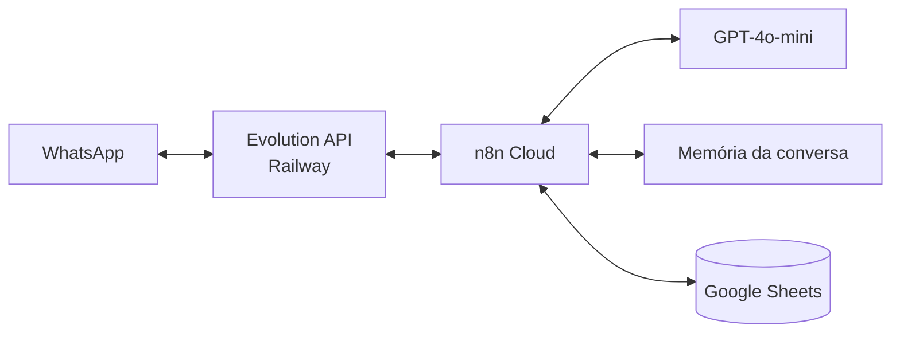

# 🤖 Promptzeiros: Atendimento por WhatsApp com IA

## 📝 Descrição do Projeto
Este projeto foi o trabalho final da disciplina de **Engenharia de Prompt e Aplicações em IA (2026.1)**, feito pelo grupo Promptzeiros. O problema escolhido: pequenas e médias empresas recebem contatos pelo WhatsApp, mas não conseguem responder rápido, não têm tempo de qualificar cada contato e têm receio de ter o número bloqueado quando fazem disparos.

A solução é um ecossistema de automação em duas frentes:
* **Inbound (atendimento):** quando alguém manda mensagem, um agente de IA faz a triagem em 4 perguntas, uma de cada vez (intenção, região, faixa de orçamento e urgência, num roteiro BANT adaptado), e no fim passa o contato para um atendente humano.
* **Outbound (disparo):** a partir de uma planilha de leads com consentimento, o sistema envia mensagens para um contato por vez, com travas para reduzir o risco de bloqueio.

Integrantes: Gustavo Cavalcante de Amorim (líder), Renan Silva dos Santos, Mateus Felicio, Cauã Martins Aziago, Leonardo Alves, Laura Maciel, Denner Souza, Pedro Souza, Kayky Fernandes e João Lucas Moreira Dos Reis.

## 🚀 Tecnologias Utilizadas
* **Orquestração:** n8n Cloud (fluxo Inbound com 11 nós e fluxo Outbound com 15 nós)
* **Modelo de linguagem:** OpenAI GPT-4o-mini
* **WhatsApp:** Evolution API, hospedada no Railway
* **Dados:** Google Sheets (leads, status de envio e opt-out)
* **Engenharia de prompt:** system prompt com os 5 elementos de Carraro (2023) em tags XML: contexto, instrução, formato obrigatório, exemplos e restrições

## 📊 Resultados e Aprendizados
Os dois fluxos, o system prompt e o memorial de construção foram entregues e apresentados em 05/05/2026.
* **O prompt é a peça que muda:** para atender outro tipo de negócio, como uma clínica ou um escritório, basta trocar o contexto e os exemplos do system prompt. A estrutura dos fluxos continua a mesma.
* **Formato pensado para o WhatsApp:** o prompt pede texto puro, sem emoji nem markdown, com no máximo 2 linhas. No fim da triagem o agente gera o marcador `TRIAGEM_COMPLETA` com os 4 dados em JSON, que o fluxo consegue ler.
* **Travas anti-bloqueio:** espera aleatória de 15 a 90 segundos entre envios, janela de horário comercial (9h às 12h e 13h às 18h), 3 modelos de mensagem alternados, checagem se o número tem WhatsApp, status "digitando..." e opção de sair em toda mensagem.
* **LGPD:** só entram no disparo os leads com consentimento marcado na planilha, e quem responde SAIR deixa de receber mensagens.
* **Limitações assumidas:** a Evolution API não é oficial e tem risco de bloqueio, então para uso real o indicado é a API oficial da Meta ou um provedor oficial. A memória da conversa se perde se o n8n reiniciar, e o Google Sheets não escala como banco de dados.

## 🔧 Como Executar
1. Importe os dois arquivos JSON da pasta `workflows/` no n8n (Cloud ou self-hosted).
2. Conecte as credenciais nos nós que pedem (Google Sheets e a autenticação da Evolution API).
3. Troque a URL da Evolution e o ID da planilha pelos seus. Nos arquivos eles aparecem como marcadores entre `< >`.
4. Ative os dois fluxos e mande "oi" no WhatsApp pareado.
5. O system prompt completo está em `prompts/system-prompt-v7.md` e os diagramas dos fluxos em `DIAGRAMA.md`. O repositório original do grupo, com o memorial e os slides da apresentação, é o [Projeto-promptzeiros](https://github.com/Rsant271/Projeto-promptzeiros).

---
[Voltar ao início](https://github.com/Rsant271/portfolio-renan-silva-dos-santos)
