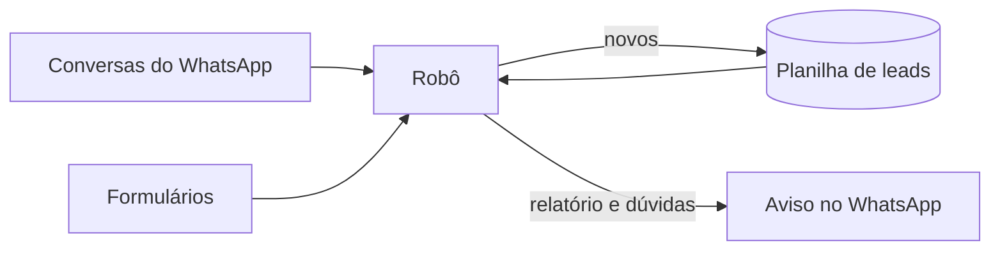

# 🤖 Robô de Varredura de Leads (estudo de caso)

## 📝 Descrição do Projeto
Este é um projeto pessoal, fora das disciplinas, que está em produção desde o fim de setembro de 2026 na mesma clínica odontológica do [CRM de leads](../projeto-crm-de-leads-whatsapp/). Os contatos chegam por vários caminhos: conversa no WhatsApp vinda de anúncio, formulário e busca no Google. Antes do robô, alguém precisava abrir cada conversa, conferir se a pessoa já estava na planilha, descobrir de onde ela veio e copiar a linha na aba do mês.

O robô faz essa varredura sozinho, várias vezes por dia:
1. lê as conversas novas do WhatsApp e os formulários que chegam numa planilha;
2. cruza cada telefone com todas as abas mensais da planilha de leads;
3. classifica cada contato como novo, já cadastrado, resposta a um disparo, dúvida ou lixo (teste ou número da própria clínica);
4. grava os novos na aba do mês e manda um relatório pelo WhatsApp. Os casos de dúvida nunca são gravados: eles vão no relatório para uma pessoa decidir.

Este é um estudo de caso. O código completo não está publicado porque depende das credenciais e da planilha da clínica. A pasta `trechos/` tem três partes do código, simplificadas e com telefones fictícios.

## 🚀 Tecnologias Utilizadas
* **Linguagem:** Python 3 (requests, expressões regulares e threads)
* **WhatsApp:** Evolution API, para ler as conversas
* **Planilha:** Google Sheets API, para ler e gravar as abas
* **Servidor:** Railway, com o robô ligado 24 horas
* **Configuração:** horários, modo e freios por variável de ambiente; segredos nunca ficam no código
* **Apoio de IA:** o código foi escrito com o Claude Code, assistente de programação da Anthropic. Eu defini as regras de classificação, tomei as decisões do projeto (modo ensaio, freios, dúvida sempre para revisão humana), conferi os relatórios e opero o robô.



## 📊 Resultados e Aprendizados
* **O bug do 9º dígito:** na versão 4, a normalização colocava o 9 em qualquer telefone de 10 dígitos. Para celular antigo isso está certo, mas um telefone fixo (que começa com 2 a 5 depois do DDD) virava o celular de outra pessoa, e o robô gravaria um contato errado. A revisão pegou o problema antes do deploy. A versão 4.1, que entrou no ar em 29/09/2026, só coloca o 9 quando o número começa com 6 a 9, e o fixo vai para a lista de dúvidas. Trecho: [`trechos/normaliza_telefone.py`](trechos/normaliza_telefone.py).
* **Ensaio antes de escrever:** o robô só grava na planilha quando a variável `SWEEP_MODO` vale `escrever`. Sem ela, ele faz a mesma análise e só manda o relatório dizendo o que gravaria. Isso permite testar uma regra nova em produção sem mexer na planilha. Trecho: [`trechos/modo_ensaio.py`](trechos/modo_ensaio.py).
* **Freio sem precisar de deploy:** com `SWEEP_STOP=1` o robô pula a próxima varredura. As outras rotinas do mesmo servidor têm o seu próprio freio. Trecho: [`trechos/freio.py`](trechos/freio.py).
* **Duplicado pelos 8 últimos dígitos:** o mesmo número escrito com ou sem 55, com ou sem o 9, é reconhecido como a mesma pessoa. E o telefone gravado é sempre o que veio da fonte, nunca um número montado pelo robô.
* **Relatório que conta o que ficou de fora:** o aviso informa quantas conversas foram ignoradas por não ter um telefone identificado. Sem esse número, quem lê o relatório não tem como saber se algum contato ficou para trás.

## 🔧 Como Executar
O robô real roda no Railway como um processo que fica ligado (`python sweep_leads.py --daemon`). Ele não funciona fora da conta da clínica, porque depende do WhatsApp conectado na Evolution API e da planilha. Os trechos rodam em qualquer computador com Python 3, sem instalar nada:

```bash
python3 trechos/normaliza_telefone.py
python3 trechos/modo_ensaio.py
SWEEP_MODO=escrever python3 trechos/modo_ensaio.py
SWEEP_STOP=1 python3 trechos/freio.py
```

---
[Voltar ao início](https://github.com/Rsant271/portfolio-renan-silva-dos-santos)
